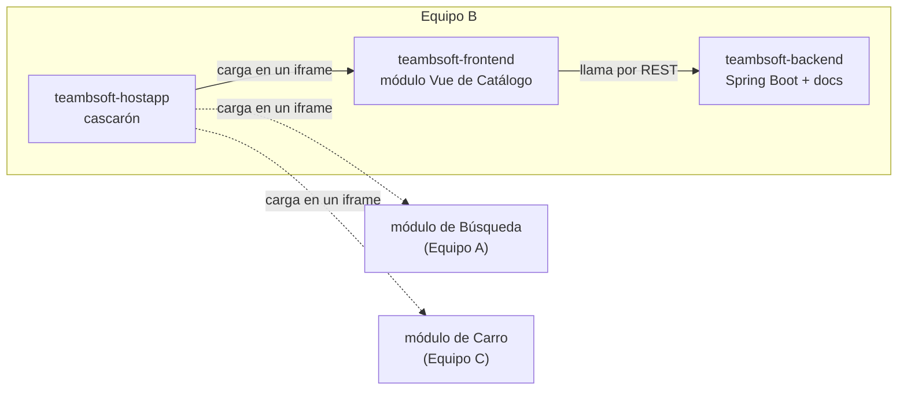

# Informe del Sprint 1 — Microservicio de Catálogo

**Equipo B** · Ingeniería de Software II · Universidad Industrial de Santander (UIS)\
**Proyecto:** Tienda Virtual con arquitectura de microservicios\
**Periodo del Sprint 1:** 18 de septiembre – 8 de octubre de 2026\
**Versión del informe:** 1.0 · 8 de octubre de 2026\
**Repositorios:**
- Backend y documentación: https://github.com/rancesra/teambsoft-backend
- Módulo de frontend: https://github.com/rancesra/teambsoft-frontend
- Host App: https://github.com/rancesra/teambsoft-hostapp

---

## 1. Resumen ejecutivo

El Sprint 0 dejó los acuerdos y la base del servicio. El Sprint 1 es el de **construcción**: completar el CRUD de productos, levantar el módulo de frontend y armar el **Host App**, el cascarón donde se cargan los módulos de los tres equipos.

Al cierre del sprint, **el backend implementa las 8 historias y los 8 endpoints del contrato v2.3**, con 46 pruebas automáticas en verde. El frontend tiene su base y la pantalla de administración completa, y el Host App carga el módulo de Catálogo y deja listos los espacios de Búsqueda y Carro. Durante el sprint, la revisión cruzada con los contratos de los equipos A y C llevó a una versión nueva del contrato (v2.3), con dos historias y dos endpoints más.

Quedaron pendientes dos tareas: **la infraestructura y los eventos (B4)** y **las vistas públicas del frontend (F2)**. Por eso, Kong, Eureka y RabbitMQ siguen diseñados en el contrato, pero no están integrados.

| Indicador | Sprint 0 | Sprint 1 |
|---|---|---|
| Historias definidas | 6 | **8** |
| Historias implementadas en el backend | 1 | **8 de 8** |
| Historias con pantalla en el frontend | 0 | **6 de 8** (faltan la 2 y la 3, de F2) |
| Endpoints del contrato | 6 definidos, 1 implementado | **8 definidos, 8 implementados** |
| Versión del contrato | v2.2 | **v2.3** |
| Pruebas automáticas | 7 | **46**, todas en verde |
| Repositorios | 1 | **3** |
| Pull requests unidos en el sprint | 2 | **13** |
| Tareas del plan terminadas | 1 de 8 (B1) | **6 de 8** (faltan B4 y F2) |

---

## 2. Integrantes y lo que hizo cada uno

| Integrante | GitHub | Tarea | Estado | Qué entregó |
|---|---|---|---|---|
| Rances Alejandro Ramírez Morillo | `rancesra` | B1 · H1 · coordinación (Scrum Master) | ✅ | Base del backend (Sprint 0), separación en tres repositorios, contrato v2.3, contrato del Host App, **Host App**, guías paso a paso de cada tarea y tablero de Jira |
| Hector Julian Franco Trujillo | `hecfrantuis` | B2 — Escritura | ✅ | `POST` y `PUT` de productos con sus validaciones, reactivación y descuento atómico de stock |
| Jhon Jairo Velandia Ramirez | `jhon613` | B3 — Lectura y borrado | ✅ | Listado paginado con filtros por categoría y por estado, detalle y `DELETE` (soft delete) |
| Cristian Rivera | `cristian007369` | B4 — Infraestructura y eventos | ❌ Sin entregar | — |
| Juan Diego Tellez Quintero | `JuanDTQ19` | F1 — Base del frontend | ✅ | Proyecto Vue, enrutador, cliente de la API, componentes de estado y proxy de desarrollo |
| Roger Sergio Hernandez | `RogerH2105` | F2 — Vistas de lectura | ❌ Sin entregar | — |
| Carlos Andrés Beltrán Ardila | `andress15s` | F3 — Vistas de administración | ✅ | Tabla de administración, formulario de crear y editar, retirar y reactivar |

> El Host App no estaba en el plan del Sprint 0. Se agregó como tarea **H1** cuando los tres equipos acordaron que lo construyera el Equipo B (sección 4.4), y la tomó el coordinador para no recargar al equipo de frontend.

---

## 3. De un repositorio a tres

En el Sprint 0 todo vivía en un solo repositorio, `teambsoft`, con el backend en la carpeta `backend/`. El 21 de septiembre, antes de que existiera código de frontend, el proyecto se separó en tres repositorios:

| Repositorio | Qué contiene | Quién trabaja ahí | Cómo se construye |
|---|---|---|---|
| **teambsoft-backend** (antes `teambsoft`) | El microservicio en Spring Boot y **toda la documentación** | B1 a B4 | Maven; se despliega como contenedor |
| **teambsoft-frontend** (nuevo) | El módulo de frontend de Catálogo en Vue y sus mockups | F1 a F3 | Vite; se carga dentro del Host App |
| **teambsoft-hostapp** (nuevo) | El cascarón que carga los módulos de los tres equipos | H1 | Vite; es lo que abre el usuario |



**Por qué se separó:**

- **Cada parte tiene su propio ciclo y sus propias herramientas.** El backend se compila con Maven y el frontend con Vite. Separados, cada repositorio tiene la forma que esperan sus herramientas: la raíz del repositorio del backend es la raíz del proyecto Maven.
- **Las revisiones quedan separadas.** Un cambio de Vue no pasa por la revisión del código Java, y al revés.
- **El Host App no es solo de Catálogo.** Lo usan los tres equipos, así que no puede vivir dentro del módulo de uno de ellos: si estuviera en nuestro frontend, los equipos A y C dependerían de un repositorio que no tiene nada que ver con su módulo.
- **Se hizo en el momento más barato.** Como todavía no había código de frontend, la separación no obligó a reescribir el historial de git.

**El costo:** la documentación no se duplica. El contrato, las historias y la arquitectura viven solo en el repositorio del backend, y los otros dos los enlazan. Además, ahora hay tres repositorios que clonar y mantener al día, y las versiones de Vue y Vite de los módulos se tienen que mantener alineadas (sección 7 del contrato del Host App). La decisión quedó registrada en la arquitectura v1.3.

---

## 4. Cambios en los acuerdos

### 4.1 Contrato de servicio: v2.2 → v2.3

Al revisar los contratos de **Búsqueda v1.0** (Equipo A) y **Carrito v1.1** (Equipo C), aparecieron cosas que nos pedían y que nuestro contrato no tenía. Todos los cambios son **compatibles**: ningún equipo tiene que modificar lo que ya había construido.

| Cambio | Quién lo pedía | Por qué |
|---|---|---|
| `descripcion` y `stock` en el contenido de los eventos | Búsqueda (bloqueante) | Sin la descripción no puede hacer búsqueda de texto completo |
| Evento nuevo `producto.reactivado` | Búsqueda | Preguntaban qué pasaba si un producto volvía a la venta |
| `POST /productos/{id}/activar` | Revisión propia | `PUT` ignora `activo` a propósito, así que un producto desactivado no tenía forma de volver |
| `POST /productos/descontar-stock` | Carrito (bloqueante) | Lo necesitan en el checkout, para responder `STOCK_INSUFICIENTE` de forma confiable |
| Parámetro `?activo=true\|false\|todos` en `GET /productos` | Revisión propia | La administración no podía encontrar los productos que había desactivado |
| Error `STOCK_INSUFICIENTE` (409) | Carrito | Con el mismo nombre y código que ya usaba Carrito |
| §9: el Host App queda a cargo del Equipo B | Acuerdo de los 3 equipos | Su integración se documenta en `CONTRATO-HOSTAPP.md` |

### 4.2 Historias de usuario: v1.1 → v1.2

Dos historias nuevas, que salen de la misma revisión cruzada:

- **Historia 7 — Reactivar producto:** como administrador, quiero volver a activar un producto que había desactivado, para ponerlo de nuevo a la venta sin tener que crearlo otra vez.
- **Historia 8 — Ver los productos desactivados:** como administrador, quiero ver también los productos que desactivé, para poder encontrarlos y reactivarlos.

El descuento de stock no se escribió como historia, porque no lo pide una persona: es un servicio que consume el checkout de Carrito. La razón quedó anotada en `HISTORIAS.md`.

### 4.3 Arquitectura: v1.2 → v1.5

| Versión | Cambio |
|---|---|
| v1.3 | Separación en repositorios (sección 3) |
| v1.4 | Cómo se descuenta el stock: con una operación atómica de MongoDB, no con transacciones (sección 5.1) |
| v1.5 | Se enlaza el diagrama del sistema completo y se actualizan las rutas tras ordenar la documentación |

### 4.4 Contrato del Host App: v1.0 → v1.1 (nuevo)

Es el acuerdo de cómo cada equipo integra su módulo al cascarón: qué rutas le tocan a cada uno, qué tiene que cumplir su módulo y qué variables de estilo se comparten.

- **v1.0 (21 de septiembre):** versión inicial. En la etapa 1, el Host App solo **enlazaba** a cada módulo.
- **v1.1 (4 de octubre):** la etapa 1 pasa de enlaces a **iframes**. Con enlaces, al abrir un módulo el usuario se salía del cascarón. Con iframes, el encabezado se queda fijo y el módulo se carga adentro, sin que ningún equipo tenga que cambiar cómo construyó el suyo.

La **etapa 2**, con *Module Federation*, sigue planteada en el contrato para cuando los módulos necesiten compartir información, como el contador del carrito en el encabezado.

---

## 5. Lo construido

### 5.1 Backend

| Método | Endpoint | Historia | Responsable | Estado |
|---|---|---|---|---|
| GET | `/categorias` | 6 | Rances (B1) | ✅ |
| POST | `/productos` | 1 | Hector (B2) | ✅ |
| PUT | `/productos/{id}` | 4 | Hector (B2) | ✅ |
| POST | `/productos/{id}/activar` | 7 | Hector (B2) | ✅ |
| POST | `/productos/descontar-stock` | — (lo usa Carro) | Hector (B2) | ✅ |
| GET | `/productos` con `?categoria`, `?activo`, `?pagina` y `?tamanoPagina` | 2 y 8 | Jhon (B3) | ✅ |
| GET | `/productos/{id}` | 3 | Jhon (B3) | ✅ |
| DELETE | `/productos/{id}` | 5 | Jhon (B3) | ✅ |

**La decisión técnica más importante del sprint fue el descuento atómico de stock.** El stock se descuenta con una sola operación de MongoDB, que resta la cantidad solo si el producto está activo y todavía tiene unidades suficientes. MongoDB garantiza que una operación sobre un mismo documento no se mezcla con otra, así que si dos clientes compran la última unidad al mismo tiempo, uno lo logra y el otro recibe `409 STOCK_INSUFICIENTE`.

Se descartaron dos alternativas:
- **Transacciones de varios documentos:** exigen un conjunto de réplicas de MongoDB, y esta entrega corre un solo nodo. Si en un mismo pedido falla un producto, el servicio devuelve el stock que ya había descontado de los demás. Es una compensación de mejor esfuerzo, pero suficiente para el alcance actual.
- **Reserva con retención** (apartar el stock y liberarlo si se vence el tiempo): necesita un proceso que libere las reservas vencidas, y ese proceso le tocaría a Órdenes, que no tiene equipo asignado.

### 5.2 Frontend

| Ruta | Pantalla | Tarea | Estado |
|---|---|---|---|
| `/catalogo` | Listado público, para el cliente | F2 | ❌ Es solo un marcador de posición |
| `/catalogo/:id` | Detalle público de un producto | F2 | ❌ Es solo un marcador de posición |
| `/catalogo/admin` | Tabla de administración con filtros Activos, Retirados y Todos, más los botones de retirar y reactivar | F3 | ✅ |
| `/catalogo/admin/nuevo` | Formulario para crear un producto, con las categorías de `GET /categorias` | F3 | ✅ |
| `/catalogo/admin/:id` | Formulario para editar un producto | F3 | ✅ |

**Base del módulo (F1):**
- El enrutador con todas las rutas, incluida una página para las rutas que no existen.
- Un cliente de la API que traduce los errores del contrato (`{codigo, mensaje}`) y avisa cuando no hay conexión con el servidor.
- Los componentes de estado que comparten todas las vistas: cargando, vacío, error y paginador.
- Un **proxy de Vite** que imita a Kong: el frontend pide `/api/catalogo/productos`, y el proxy quita el prefijo y se lo pasa al backend como `/productos`. Así, el código del frontend no cambia cuando entre Kong.

**Vistas de administración (F3):** además de las pantallas, Carlos agregó un aviso de éxito, un diálogo para confirmar antes de retirar un producto y funciones para formatear los precios.

### 5.3 Host App

- **Encabezado y menú** fijos, con Catálogo, Búsqueda y Carrito.
- **Enrutador por módulo:** todo lo que empieza por `/catalogo` lo atiende Catálogo, y así con cada módulo.
- **Cada módulo se carga en un iframe** con la dirección que trae `.env.development`. El Host App comprueba si el módulo responde y muestra uno de tres avisos: cargando, no responde, o todavía no está conectado.
- **El módulo detecta si corre dentro del Host App** (`window.self !== window.top`) y, en ese caso, no pinta su propio encabezado, para que no salgan dos.

Hoy solo está conectado Catálogo. Para conectar Búsqueda y Carro, cada equipo solo tiene que poner la dirección de su módulo en `.env.development`, sin tocar el código del Host App.

---

## 6. Evidencias de verificación

### 6.1 Pruebas automáticas

`./mvnw test` → **46 pruebas, 0 fallas, 0 errores** (8 de octubre, sobre `main`).

| Clase de prueba | Pruebas | Tarea |
|---|---|---|
| `CatalogoApplicationTests` | 1 | B1 |
| `ManejadorGlobalErroresTest` | 6 | B1 |
| `ProductoControllerTest` | 10 | B2 |
| `ProductoLecturaControllerTest` | 18 | B3 |
| `ProductoServiceListadoTest` | 11 | B3 |

Las pruebas son de dos tipos:

- **34 de la capa web** (`@WebMvcTest` con MockMvc): `ProductoControllerTest`, `ProductoLecturaControllerTest` y `ManejadorGlobalErroresTest`. Cargan solo los controllers, con el servicio simulado (`@MockitoBean`), y comprueban lo que exige el contrato: rutas, códigos de estado, validaciones y el formato de los errores. No necesitan MongoDB.
- **12 de integración** (`@SpringBootTest`): `ProductoServiceListadoTest` y `CatalogoApplicationTests`. Levantan el servicio completo contra un MongoDB real, y comprueban la paginación, los filtros y el total del listado.

No hay pruebas automáticas del frontend ni pruebas de carga.

### 6.2 Prueba de los endpoints con el servicio corriendo

Ejecutada el 8 de octubre sobre `main`, contra una base de datos vacía:

| Caso | Respuesta |
|---|---|
| `GET /actuator/health` | 200, `"status":"UP"`, también en `mongo` |
| `POST /productos` válido | 201, con `id` y `activo: true` |
| `POST` sin nombre, con precio 0 y stock -1 | 400 `VALIDACION_FALLIDA`, que nombra los tres campos |
| `POST` con una categoría que no existe | 400 `VALIDACION_FALLIDA`: *"La categoría 'cat-nada' no existe"* |
| `GET /productos?categoria=cat-ropa` | 200, `total: 1`, `pagina: 1`, `tamanoPagina: 20` |
| `GET /productos/{id}` | 200 con el producto |
| `GET /productos/{id}` con un id que no existe | 404 `PRODUCTO_NO_ENCONTRADO` |
| `PUT /productos/{id}` con precio nuevo | 200 con el precio actualizado |
| Descontar 1 unidad de un producto con 2 | 200, `stockRestante: 1` |
| Descontar 5 unidades de un producto con 1 | 409 `STOCK_INSUFICIENTE`, y el stock no cambia |
| `DELETE /productos/{id}`, y repetido | 204 las dos veces (idempotente) |
| `GET /productos` después del `DELETE` | 200, `total: 0`: el producto retirado ya no aparece |
| `GET /productos?activo=false` | 200 con el producto retirado, con `activo: false` |
| `POST /productos/{id}/activar` | 200, `activo: true` |
| `GET /productos?pagina=0` | 400 `VALIDACION_FALLIDA`: *"pagina: debe ser 1 o más"* |

### 6.3 Frontend y Host App

| Verificación | Resultado |
|---|---|
| Compilación del frontend (`vite build`) | Sin errores |
| Revisión de código del frontend (`npm run lint`) | Sin errores ni advertencias |
| Compilación del Host App (`vite build`) | Sin errores |
| `http://localhost:5050/catalogo/admin` | El Host App carga el módulo de Catálogo con un solo encabezado, y la administración funciona contra el backend real |

### 6.4 Pull requests unidos en el sprint

| Repositorio | PR | Contenido | Autor |
|---|---|---|---|
| backend | #3 | Informe del Sprint 0 | rancesra |
| backend | #4 | Separa el módulo en dos repositorios | rancesra |
| backend | #5 | Mockups del frontend y pendientes del contrato | rancesra |
| backend | #6 | Contrato v2.3, historias v1.2, arquitectura v1.4 y tarea H1 | rancesra |
| backend | #7 | Guías paso a paso para cada tarea | rancesra |
| backend | #8 | Ordena la documentación del repositorio | rancesra |
| backend | #9 | B2: POST y PUT de productos con sus validaciones | hecfrantuis |
| backend | #10 | B3: listado paginado, detalle y DELETE | jhon613 |
| frontend | #1 | F1: base del módulo | JuanDTQ19 |
| frontend | #2 | F3: vistas de administración | andress15s |
| frontend | #3 | Corrige el cliente de la API | rancesra |
| frontend | #4 | Oculta el encabezado del módulo dentro del Host App | rancesra |
| hostapp | #1 | H1: cascarón del Host App | rancesra |

---

## 7. Organización del trabajo

### 7.1 Scrum y Jira

El equipo trabaja con Scrum. El tablero está en Jira, con la clave de proyecto **`CAT`**:

- **Jerarquía:** una épica por frente (Backend, Frontend, Host App y Documentación) → una historia por cada historia de usuario → una tarea por cada pieza técnica (B1 a B4, F1 a F3 y H1).
- **Estados:** Por hacer → En curso → En revisión (al abrir el pull request) → Listo (al unirlo).
- El backlog completo se cargó a Jira desde un archivo, que está en `docs/guias/jira-backlog.csv`.

### 7.2 Una guía por tarea

Cada integrante recibió una guía paso a paso en `docs/guias/`, con el código probado antes de entregarlo y, al final de cada paso, el comando para comprobar que quedó bien. Las guías están escritas para Windows (PowerShell), que es el sistema de seis de los siete integrantes.

| Guía | Para quién |
|---|---|
| `GUIA-INICIO.md` | Todos: instalar las herramientas y dejar el proyecto corriendo |
| `GUIA-GIT.md` | Todos: ramas, commits, pull requests y conflictos |
| `JIRA.md` | Todos: el tablero, los estados y la clave del ticket en las ramas |
| `B2-ESCRITURA.md`, `B3-LECTURA.md`, `B4-INFRAESTRUCTURA.md` | Hector, Jhon y Cristian |
| `F1-BASE.md`, `F2-LECTURA.md`, `F3-ADMINISTRACION.md` | Juan Diego, Roger y Carlos |

### 7.3 Lo que no se cumplió del proceso

El código funciona, pero tres reglas del proceso no se cumplieron, y conviene decirlo:

- **Los pull requests no tienen una revisión formal registrada en GitHub.** La definición de terminado exige que otro integrante revise cada PR antes de unirlo. B2 y B3 los unió su propio autor. F1 lo unió otro integrante (Carlos), y F3 se unió después de probarlo, pero ninguno quedó aprobado formalmente en GitHub.
- **Las ramas y los commits no llevan la clave de Jira** (por ejemplo, `CAT-12`). Sin la clave, Jira no enlaza el código con la tarjeta, y el tablero se quedó atrás de lo que de verdad está hecho.
- **B2 y B3 no marcaron sus casillas en el README.** Se marcaron al cerrar el sprint, después de verificar cada endpoint (sección 6.2).

---

## 8. Incidentes y lecciones

| Incidente | Qué se hizo | Lección |
|---|---|---|
| El cliente de la API enviaba `body` en las peticiones `GET`, y el revisor de código lo marcaba como error. El error venía en el código de la guía de F1 | Se corrigió el código (PR frontend #3) y la guía | Al probar el código de una guía, también hay que pasarle el revisor de código, no solo compilarlo |
| Dentro del Host App se veían dos encabezados: el del cascarón y el del módulo | El módulo detecta si corre dentro de un iframe y oculta el suyo (PR frontend #4) | Cada módulo tiene que poder correr solo y también dentro del cascarón |
| Con el Host App v1.0, al pulsar un módulo el usuario se salía del cascarón | Se pasó de enlaces a iframes (contrato del Host App v1.1) | Primero se cambió el documento y después el código, para que los equipos A y C se enteraran del cambio |
| F2 y F3 iban a crear el mismo archivo de formato de precios | Carlos lo creó en F3, y la guía de F2 se actualizó para reutilizarlo | Cuando dos tareas comparten un archivo, hay que decidir antes quién lo crea |
| El MongoDB instalado localmente en un equipo ocupaba el mismo puerto (27017) que el de Docker | Se apaga el servicio local antes de levantar Docker | Si el servicio no se conecta, revisar primero qué está usando el puerto |

---

## 9. Lo pendiente y los riesgos

### 9.1 Tareas sin entregar

| Tarea | Qué falta | Qué afecta |
|---|---|---|
| **B4** — Infraestructura y eventos | Publicar los 4 eventos en RabbitMQ, el Dockerfile del servicio, el registro en Eureka, la ruta en Kong y Swagger | Búsqueda no puede construir su índice con nuestros eventos, y la integración por Kong no se puede mostrar |
| **F2** — Vistas de lectura | El listado público y el detalle | El cliente de la tienda todavía no tiene pantalla. Los endpoints sí funcionan |

### 9.2 Riesgos

| Riesgo | Impacto | Mitigación |
|---|---|---|
| Que B4 no avance y la integración con los equipos A y C quede para el final | Alto | El contrato ya define el exchange, los eventos y su contenido, y la guía de B4 tiene el código probado. Se propone partir B4 en entregas pequeñas |
| Que se guarde un cambio en Mongo y el evento no llegue a RabbitMQ | Medio | Guardar y publicar no son una sola operación. Para esta entrega se asume el riesgo; la solución estándar es el patrón *Transactional Outbox* |
| Que se una código a `main` sin que nadie lo revise | Medio | Proteger `main` en GitHub para que todo PR necesite una aprobación |
| Que el tablero de Jira no refleje el avance real | Bajo | Poner la clave de la tarjeta en las ramas y los commits |
| Las pruebas de integración usan la misma base de datos que el desarrollo (`catalogo`), y `ProductoServiceListadoTest` borra todos los productos antes de cada prueba. Correr `./mvnw test` con datos de demostración los elimina | Medio | Que las pruebas usen su propia base de datos (por ejemplo, `catalogo_pruebas`), con un `application.yml` en `src/test/resources` |

### 9.3 Decisiones pendientes

- **El botón "Agregar al carro" en el detalle de un producto:** si lo pinta Catálogo, o si el Host App carga ahí un componente del módulo de Carrito. Se decide con el Equipo C.
- **Qué se muestra en `/`:** hoy redirige a `/catalogo`. Si se quiere una portada, hay que decidir de quién es.
- **Quién opera el Kong y el Eureka compartidos** por los tres equipos.
- **Cuándo pasar a la etapa 2 del Host App** (*Module Federation*).

---

## 10. Plan del siguiente sprint

| Objetivo | Tarea | Resultado esperado |
|---|---|---|
| Publicar los eventos | B4 | Los 4 eventos en el exchange `catalogo.eventos`, con el contenido de la v2.3 |
| Integrar la infraestructura | B4 | Dockerfile del servicio, `docker-compose` completo, registro en Eureka, ruta en Kong y Swagger |
| Completar el frontend | F2 | Listado y detalle públicos, consumiendo los endpoints reales |
| Integrar a los otros equipos | H1 | Los módulos de Búsqueda y Carro cargando en el Host App |
| Cumplir el proceso | Todos | `main` protegido, cada PR revisado por otro integrante y la clave de Jira en ramas y commits |

---

## Anexos

### A. Documentos del proyecto

| Documento | Versión | Contenido |
|---|---|---|
| [CONTRATO-CATALOGO.md](CONTRATO-CATALOGO.md) | v2.3 | Contrato con los equipos A y C |
| [CONTRATO-HOSTAPP.md](https://github.com/rancesra/teambsoft-hostapp/blob/main/CONTRATO-HOSTAPP.md) | v1.1 | Cómo se integra cada módulo al Host App |
| [HISTORIAS.md](HISTORIAS.md) | v1.2 | Las 8 historias con sus criterios de aceptación |
| [ARQUITECTURA-CATALOGO.md](ARQUITECTURA-CATALOGO.md) | v1.5 | Stack, capas internas y decisiones de diseño |
| [PLAN-DE-TRABAJO.md](PLAN-DE-TRABAJO.md) | — | Tareas, dependencias y definición de terminado |
| [INFORME-SPRINT-0.md](INFORME-SPRINT-0.md) | 1.0 | El estado del proyecto al cerrar el sprint anterior |
| [guias/](guias/) | — | Una guía por tarea, más las de inicio, git y Jira |

### B. Cómo reproducir lo construido

Necesitas JDK 21, Node.js LTS y Docker Desktop abierto. En Windows, usa `.\mvnw.cmd` en lugar de `./mvnw`.

```bash
# Backend: en http://localhost:8080
git clone https://github.com/rancesra/teambsoft-backend.git
cd teambsoft-backend
docker compose up -d
./mvnw test
./mvnw spring-boot:run
```

```bash
# Módulo de frontend: en http://localhost:5173
git clone https://github.com/rancesra/teambsoft-frontend.git
cd teambsoft-frontend
npm install
npm run dev
```

```bash
# Host App: en http://localhost:5050
git clone https://github.com/rancesra/teambsoft-hostapp.git
cd teambsoft-hostapp
npm install
npm run dev
```

Con los tres corriendo, abre http://localhost:5050/catalogo/admin.
