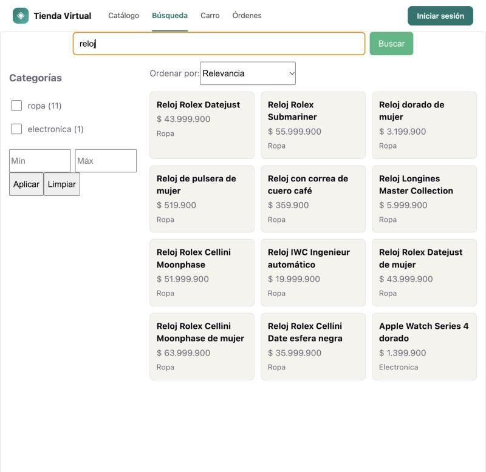
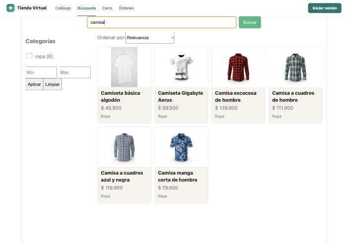

# Búsqueda en la presentación: fotos en los resultados

**De:** Equipo B (Catálogo y Host App) · **Para:** Equipo A (Búsqueda) · **Fecha:** 14 de noviembre de 2026\
**Plazo:** junto con los otros dos parches, en `main` **el lunes 16 de noviembre**.

## En resumen

En la tienda, Catálogo muestra cada producto con su foto, pero los resultados de Búsqueda salen solo con texto. Desde el **contrato de Catálogo v2.6**, los eventos traen las fotos, y para mostrarlas basta un **tercer parche, pequeño**: [`busqueda-fotos.patch`](busqueda-fotos.patch). Solo cambia el frontend.

| Hoy | Con el parche |
|---|---|
|  |  |

## Qué cambió en Catálogo (v2.6)

Los eventos `producto.creado`, `producto.actualizado` y `producto.reactivado` agregan un campo:

| Campo | Tipo | Qué es |
|---|---|---|
| `imagenes` | arreglo de strings | Las URLs de las fotos del producto. Puede venir vacío |

**Su backend no tiene que cambiar nada.** Su consumidor guarda el evento completo, el índice acepta campos nuevos y la búsqueda devuelve todo lo guardado. Lo comprobamos: con la v2.6, `GET /api/busqueda/productos?q=camiseta` ya devuelve `imagenes` en cada resultado.

## Qué cambia el parche

`busqueda-frontend/src/App.vue`: cada tarjeta de resultado muestra `imagenes[0]` arriba, en un recuadro 4:3 fijo, con o sin foto, para que las tarjetas de una fila queden parejas. Usa `object-fit: contain` para que el producto se vea completo, sin recortarlo.

## Cómo aplicarlo

En la misma rama, **después** de `busqueda-integracion.patch` y `busqueda-eureka.patch` (se apoya en la tarjeta que deja el primero):

```bash
git apply busqueda-fotos.patch
cd busqueda-frontend
npm run build
```

**Los productos que ya estaban indexados no tienen foto** hasta que les llegue un evento nuevo. Para la demostración se levanta la tienda desde cero, y Catálogo vuelve a anunciar todo con las fotos:

```bash
docker compose down -v
docker compose up -d --build
```

**Qué comprobamos:** el frontend compila, y dentro del Host App la búsqueda «camisa» muestra los 6 resultados con su foto, como en la captura.
