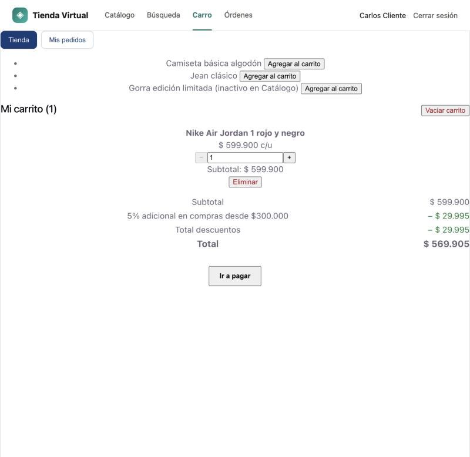
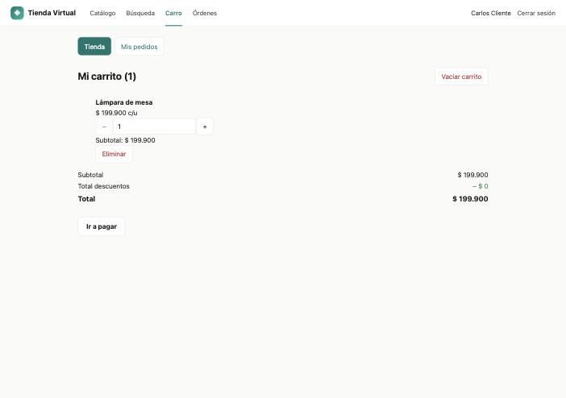

# Carrito en la presentación: ajustes visuales

**De:** Equipo B (Catálogo y Host App) · **Para:** Equipo C (Carrito) · **Fecha:** 14 de noviembre de 2026\
**Plazo:** junto con los otros dos parches, en `develop` **el lunes 16 de noviembre**.

## En resumen

Dentro del Host App, Carrito se ve distinto al resto de la tienda, y además muestra arriba una lista de productos de prueba que no existen en Catálogo. Lo arregla un **tercer parche, pequeño**: [`carrito-estilo.patch`](carrito-estilo.patch). No toca la lógica, solo el estilo y una línea de la plantilla.

| Hoy | Con el parche |
|---|---|
|  |  |

## Qué cambia

| # | Cambio | Por qué |
|---|---|---|
| 1 | `Frontend/src/style.css` pasa a tener solo las **variables de la tienda** (contrato del Host App, sección 6) y unos estilos base para textos, botones y campos | El archivo actual es el que trae la plantilla de Vite: color morado, modo oscuro, todo centrado y bloques (`#center`, `#next-steps`, `#docs`, `.hero`) que la aplicación no usa. Revisamos que ningún componente use sus variables |
| 2 | En `Frontend/src/App.vue`, `<ProductsDemo>` solo aparece si el módulo **no** está dentro del Host App (`v-if="!embebido"`) | Esa lista ofrece productos de prueba («Gorra edición limitada…») que no existen en Catálogo. Dentro de la tienda, los productos se agregan desde Catálogo con «Agregar al carro». Fuera del Host App la lista sigue apareciendo, como hoy |
| 3 | El menú «Tienda / Mis pedidos» usa el color de acento de la tienda (`--acento`) en lugar de `#173c78` | Que el botón activo se vea igual que en los otros módulos |

Como cada módulo corre en su propio iframe, no hereda nada del Host App: por eso las variables se definen también dentro de Carrito.

## Cómo aplicarlo

En la misma rama, **después** de `carrito-integracion.patch` y `carrito-eureka.patch` (usa la variable `embebido` del primero):

```bash
git apply carrito-estilo.patch
cd Frontend
npm run build
```

**Qué comprobamos:** el `Frontend` compila. Dentro del Host App, el carrito, el pago y «Mis pedidos» se ven con el estilo de la tienda y sin la lista de prueba, como en la captura.

## Opcional, si les sobra tiempo

Mostrar la foto de cada producto en el carrito. `GET /api/catalogo/productos/{id}` ya devuelve `imagenes`, un arreglo de URLs; la primera sirve de miniatura. No está en el parche.
